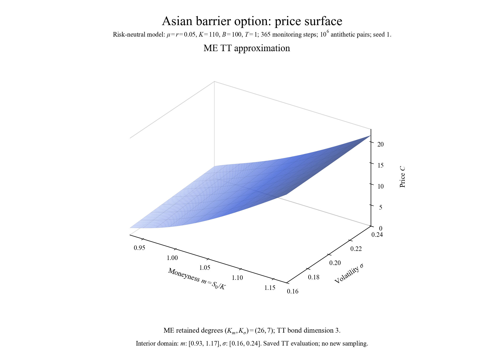
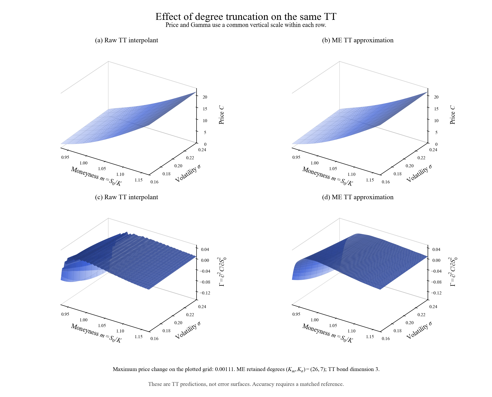
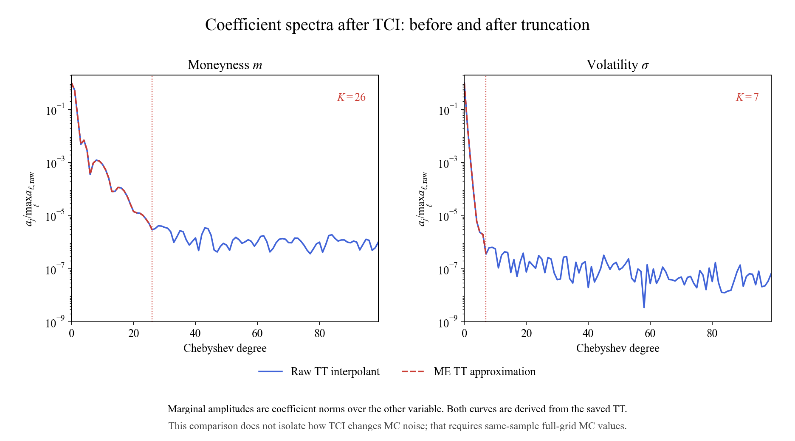

@def title = "Asian barrier option: a price surface"
@def hasmath = true
@def description = "A saved tensor-train price surface of an Asian barrier option, its Gamma, and Chebyshev coefficient spectra."

@@explainer

[← Research notes](/research/)

# Asian barrier option: a price surface

Plots of a saved tensor train for an Asian barrier call, over moneyness $m=S_0/K$ and volatility $\sigma$. After degree truncation (ME) it keeps degree 26 in $m$ and 7 in $\sigma$, with rank 3.

~~~
<figure>
  
  <figcaption>Price surface after degree truncation.</figcaption>
</figure>
~~~

## Price and Gamma

Truncation moves the plotted prices by at most 0.00111, but Gamma looks much smoother afterwards. Whether it is also more accurate needs a reference, which I haven't compared here.

~~~
<figure>
  
  <figcaption>Price on top, Gamma below. Same vertical scale within each row.</figcaption>
</figure>
~~~

## Chebyshev coefficients

The coefficients decay down to a small flat tail. The cutoffs are 26 in $m$ and 7 in $\sigma$.

~~~
<figure>
  
  <figcaption>Spectra of the saved TT. To see what TCI does to the noise, one would compare with the full Monte Carlo grid on the same samples.</figcaption>
</figure>
~~~

There are 365 monitoring steps and a barrier, and still the surface needs few coefficients. My guess is that the averaging smooths the price. Low rank is a separate thing (how the two variables couple), and smoothness alone doesn't give it.

~~~

  
Settings &amp; sources

  
Risk-neutral model: μ = r = 0.05, strike K = 110, barrier B = 100, maturity T = 1. 365 monitoring steps, 106 antithetic pairs, seed 1.

  
Plotted domain: m ∈ [0.93, 1.17], σ ∈ [0.16, 0.24]. These are evaluations of the saved TT. No new sampling and no reference comparison for these plots.

  
Source: report of 3 October 2026, <i>Asian barrier: saved TT surfaces</i> (final version).

  
Related: <a href="https://arxiv.org/abs/1505.04648">Chebyshev Interpolation for Parametric Option Pricing</a>, <a href="https://www.chebfun.org/docs/guide/guide04.html">Chebfun and Approximation Theory</a>.

~~~

[Full PDF](/assets/asian-barrier/asian_barrier_3d.pdf)

@@
