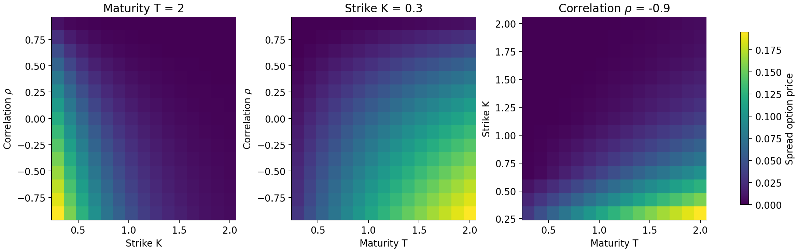
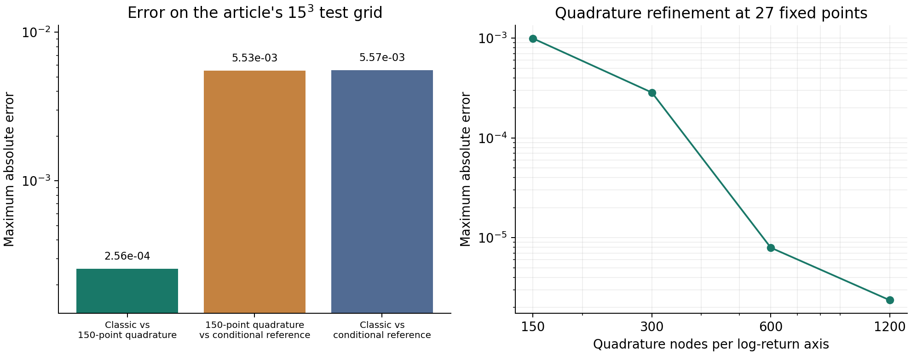

@def title = "A spread option with Chebfun3"
@def page_language = "en"
@def hasmath = true
@def description = "Reproducing Chebfun's 2017 spread-option example: a three-parameter Tucker approximation, fast evaluation, and an independent check of the quadrature error."

@@explainer

[← Research notes](/research/)

# A spread option with Chebfun3

[Glau, Hashemi, Mahlstedt and Poetz (2017)](https://www.chebfun.org/examples/applics/BlackScholes2D.html) use Chebfun3 to approximate a spread-option price as a function of maturity $T$, strike $K$ and correlation $\rho$. I reran it to see if I get the same ranks and error, and then checked the numerical integral underneath with a different method. The integral turned out to be the bigger error.

~~~
<figure>
  
  <figcaption>Slices of the reproduced Chebfun3 approximation. Both initial asset prices are 1, both volatilities are 0.3, and the risk-free rate is zero.</figcaption>
</figure>
~~~

## Model

$$
\frac{dS_i}{S_i}=r\,dt+\sigma_i\,dW_i,\qquad
dW_1\,dW_2=\rho\,dt,
$$

$$
V(T,K,\rho)=e^{-rT}\mathbb{E}\!\left[(S_1(T)-S_2(T)-K)_+\right].
$$

The log return $X_i=\log(S_i(T)/S_i(0))$ has mean $(r-\sigma_i^2/2)T$. The SDE at the start of the article seems to put this log-price drift into $dS_i/S_i$, but the integration code uses the correct log-return distribution.

Each price is computed with 150 × 150 Clenshaw–Curtis nodes on $[-10,10]^2$ in log returns. Chebfun3 then approximates the price on

$$
[0.3,2]\times[0.3,2]\times[-0.9,0.9]
$$

in $(T,K,\rho)$.

## Tucker representation

Chebfun3 stores the function as

$$
\widetilde V(T,K,\rho)=
\sum_{i=1}^{r_T}\sum_{j=1}^{r_K}\sum_{\ell=1}^{r_\rho}
G_{ij\ell}\,a_i(T)b_j(K)c_\ell(\rho).
$$

The Chebyshev lengths of $a_i$, $b_j$, $c_\ell$ set the resolution in each parameter, and the core sizes are the Tucker ranks (see the [Chebfun3 guide](https://www.chebfun.org/docs/guide/guide18.html)). The `classic` constructor with `eps = 1e-5` reproduces the 2017 example:

| Quantity | Article | My run |
| --- | --- | --- |
| Tucker ranks | 5, 10, 7 | 5, 10, 7 |
| Chebyshev lengths | 10, 42, 13 | 10, 42, 13 |
| Maximum error against the 150-point price routine | $2.5650\times10^{-4}$ | $2.56498685\times10^{-4}$ |

The lengths correspond to degrees 9, 41 and 12. Errors are taken over the same $15^3=3375$ uniformly spaced parameter points.

## Interpolation error and pricing error

The approximation can only be as good as the prices it interpolates. As a reference I condition on the second asset, compute the conditional call expectation in closed form, and integrate over one normal variable.

~~~
<figure>
  
  <figcaption>Left: the article's 3,375-point test grid. Right: a separate 27-point quadrature study, so its maximum is over different points.</figcaption>
</figure>
~~~

| Comparison on the 3,375-point grid | Maximum absolute error |
| --- | ---: |
| Classic Chebfun3 vs. 150-point quadrature | $2.5650\times10^{-4}$ |
| 150-point quadrature vs. conditional reference | $5.5339\times10^{-3}$ |
| Classic Chebfun3 vs. conditional reference | $5.5689\times10^{-3}$ |

So most of the error comes from the quadrature, not from Chebfun. The worst point is $(T,K,\rho)=(0.3,0.42142857,-0.9)$: 0.01986727 from the original quadrature vs 0.01433340 from the reference. Tightening Chebfun won't fix that. More quadrature nodes do (right panel).

At 500 additional random parameter points, the classic construction has a maximum interpolation error of $2.281\times10^{-4}$ and a maximum total error of $1.015\times10^{-3}$.

~~~

  
Timings, code &amp; checks

  
In Octave, construction took 78.95 seconds, direct pricing on the test grid 3.72 seconds, and evaluating the approximation 0.00592 seconds (median of five runs after warm-up). Construction called the price routine 62,667 times, counting repeated calls.

  
The <a href="/assets/chebfun-spread/reproduction.zip">bundle</a> has the code, outputs, figures and checks. Chebfun revision <a href="https://github.com/chebfun/chebfun/tree/7574c77680d7e82b79626300bf255498271a72df"><code>7574c77680d7e82b79626300bf255498271a72df</code></a>, GNU Octave 11.3.0. Octave lacks the two-input page-matrix multiplication this revision calls, so a small tested adapter supplies it. Chebfun itself is unchanged.

<pre><code>run_chebfun_spread('/path/to/chebfun', 'new_results')   % Octave/MATLAB
python3 -B test_reference.py
python3 -B analyse_spread.py new_results new_analysis</code></pre>
  
For a standard normal value z of the second asset, let m = −σ₁²T/2 + ρσ₁√T z, v = σ₁²T(1−ρ²) and L = exp(−σ₂²T/2 + σ₂√T z) + K. The conditional expectation of the payoff is exp(m + v/2) Φ((m + v − log L)/√v) − L Φ((m − log L)/√v). Integrating this against the standard normal density gives the reference for zero rates and unit spots.

  
The integral uses SciPy quad_vec on [−12,12] with absolute and relative tolerance 10⁻¹². Using [−10,10] and tolerance 10⁻¹¹ instead changes the grid prices by at most 1.39 × 10⁻¹⁶. At zero strike the reference agrees with the exchange-option formula at nine maturity/correlation pairs.

  
I also recomputed the Clenshaw–Curtis nodes, weights and selected prices in Python. The exported Tucker factors reproduce all saved Chebfun evaluations to within 3.4 × 10⁻¹⁶. The export includes the endpoint values that Chebfun stores separately from its coefficients.

  
The default constructor at the same revision gives ranks (5,10,7), lengths (10,29,12) and a maximum grid error of 6.0012 × 10⁻⁴ against the same quadrature.

  
Downloads: <a href="/assets/chebfun-spread/run_chebfun_spread.m">MATLAB/Octave driver</a>, <a href="/assets/chebfun-spread/analyse_spread.py">analysis script</a>, <a href="/assets/chebfun-spread/analysis/summary.json">numerical summary</a>, <a href="/assets/chebfun-spread/analysis/grid_comparison.csv">grid prices</a>, <a href="/assets/chebfun-spread/analysis/random_comparison.csv">random-point prices</a>, <a href="/assets/chebfun-spread/provenance.json">source hashes</a>.

~~~

Related: [Gaß et al. (2018), parametric option pricing](/chebyshev-pricing/) · [Compressing a smooth price surface](/compression/) · [Chebyshev interpolation across a kink](/chebyshev-spline/).

[Back to research notes](/research/)

@@
