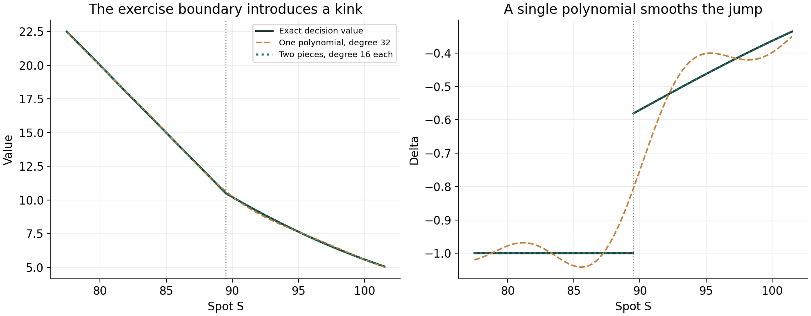
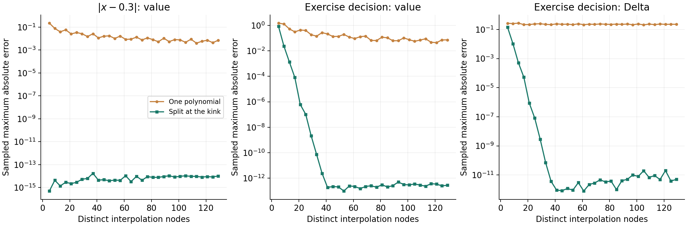

@def title = "Chebyshev interpolation across a kink"
@def page_language = "en"
@def hasmath = true
@def description = "One Chebyshev polynomial versus two pieces joined at a known kink, with value and Delta errors, reproduced from a Python demo."

@@explainer

[← Research notes](/research/)

# Chebyshev interpolation across a kink

The script `cheb_spline_demo.py` compares one Chebyshev polynomial with two polynomial pieces joined at a known kink. Both use Chebyshev–Lobatto nodes. I reran it and saved the errors of the value and of Delta. Splitting helps a lot, as expected.

~~~
<figure>
  
  <figcaption>33 distinct interpolation nodes in each case. The kink location is known before interpolation.</figcaption>
</figure>
~~~

## Two examples

The first is $f(x)=|x-0.3|$ on $[-1,1]$. Split at $x=0.3$, both pieces are linear and are interpolated exactly. The remaining errors are at the level of rounding.

The second has one exercise decision,

$$
V(S)=\max\{100-S,\;P_{\mathrm{European}}(S)\},
$$

where the continuation value is a Black–Scholes European put with strike 100, rate 5%, volatility 20% and maturity one year, on the spot interval $[50,150]$. The two sides meet at

$$
S^\star=89.4952812319501.
$$

Delta is $-1$ on the left and tends to about $-0.581183$ from the right, so it jumps at $S^\star$. Exercise is possible only now or at maturity. There is no backward induction over several dates.

## Errors

~~~
<figure>
  
  <figcaption>Maximum absolute errors on 4,001 uniform points. Delta errors exclude points within 10⁻⁶ of the exercise boundary.</figcaption>
</figure>
~~~

For the exercise example:

~~~
~~~

| Distinct nodes | Value: one polynomial | Value: two pieces | Delta: one polynomial | Delta: two pieces |
| ---: | ---: | ---: | ---: | ---: |
| 17 | $3.14\times10^{-1}$ | $8.07\times10^{-5}$ | $2.16\times10^{-1}$ | $5.25\times10^{-5}$ |
| 33 | $1.44\times10^{-1}$ | $7.06\times10^{-11}$ | $2.25\times10^{-1}$ | $7.09\times10^{-11}$ |
| 65 | $1.30\times10^{-1}$ | $1.49\times10^{-13}$ | $2.30\times10^{-1}$ | $2.22\times10^{-12}$ |

~~~
~~~

One polynomial has to cover both sides of the kink, and its Delta error stays near 0.2 at every degree tested. Each of the two pieces covers a smooth branch and converges quickly until rounding error takes over, earlier for Delta than for the value.

## Counting nodes

A degree-$N$ polynomial uses $N+1$ nodes. For even $N$, two degree-$N/2$ pieces have $N+2$ nodes, but they share the one at the boundary, which leaves $N+1$ distinct nodes. The script evaluates the shared node twice, so it makes $N+2$ evaluations. Finding the boundary with Brent's method costs extra and is not included. The comparison is at equal numbers of distinct nodes, not equal run time.

The two pieces are only required to agree in value at the boundary. Requiring Delta to be continuous there would be wrong here, because the true Delta jumps.

The [parametric-pricing note](/chebyshev-pricing/) covers the smooth case, where one polynomial converges fast. This example is the opposite case: with a kink, where the interval is split matters.

~~~

  
Reproduction, checks &amp; downloads

  
The <a href="/assets/chebyshev-spline/cheb_spline_demo.py">original script</a> is kept unchanged. A <a href="/assets/chebyshev-spline/reproduce_cheb_spline.py">wrapper</a> exports its tables and draws the figures above. Everything is also in the <a href="/assets/chebyshev-spline/reproduction.zip">reproduction bundle</a>.

  
Run <code>python3 -B cheb_spline_demo.py</code> for the original plot, or <code>python3 -B reproduce_cheb_spline.py new_results</code> for the tables, checks and figures. Keep both scripts in the same folder. The saved run used Python 3.10.0, NumPy 1.26.4, SciPy 1.15.3 and Matplotlib 3.10.8.

  
The checks cover the boundary equation, interpolation at the nodes, continuity of the two pieces, and an independent barycentric evaluation. A separate 16,001-point grid confirms the error scale at degree 32. The derivative at the kink is never used as a reference.

  
Data: <a href="/assets/chebyshev-spline/results/absolute_value.csv">absolute-value errors</a> · <a href="/assets/chebyshev-spline/results/exercise_value.csv">exercise-value and Delta errors</a> · <a href="/assets/chebyshev-spline/results/summary.json">parameters, source hash and checks</a>.

  
<a href="https://numpy.org/doc/stable/reference/generated/numpy.polynomial.chebyshev.Chebyshev.fit.html">NumPy's Chebyshev.fit</a> solves a least-squares problem. With as many nodes as coefficients it is interpolation. The boundary is found with <a href="https://docs.scipy.org/doc/scipy/reference/generated/scipy.optimize.brentq.html">SciPy's brentq</a>.

~~~

[Back to research notes](/research/)

@@
