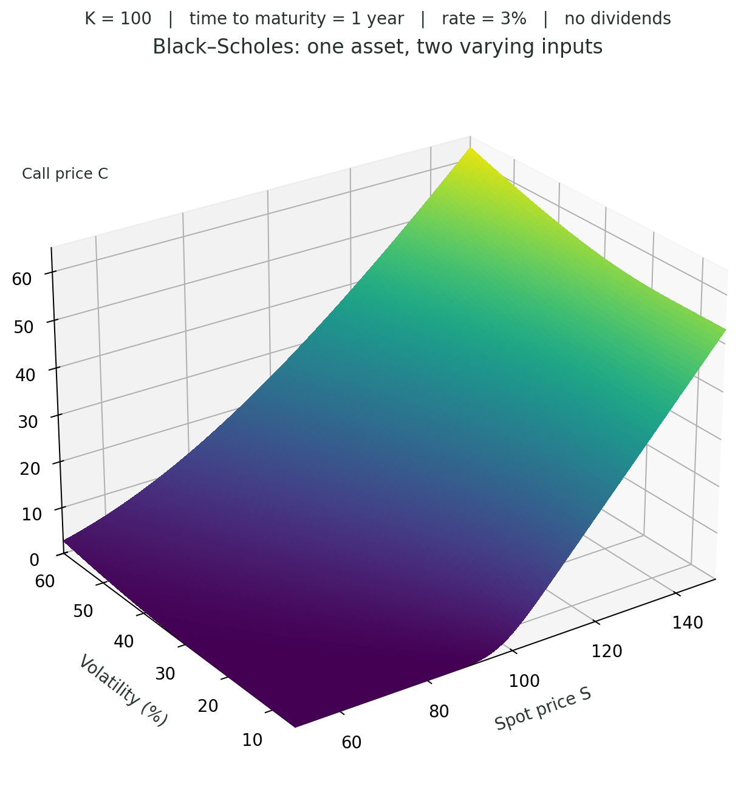
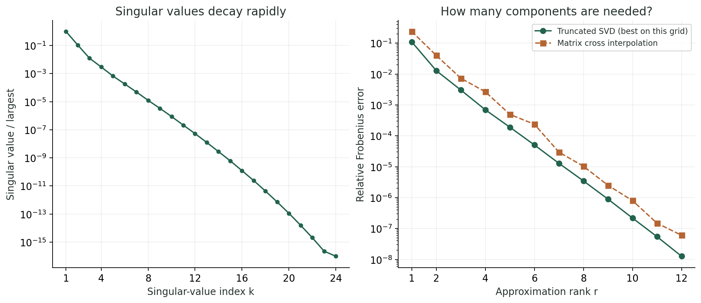
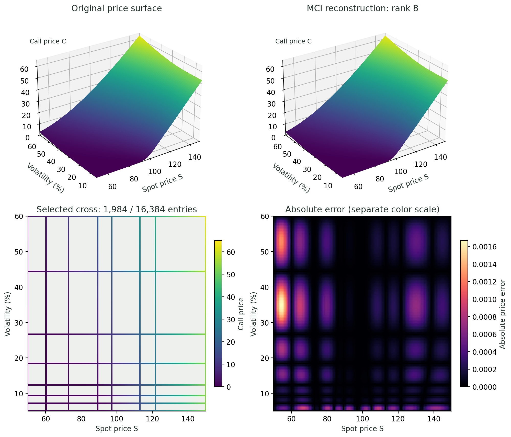
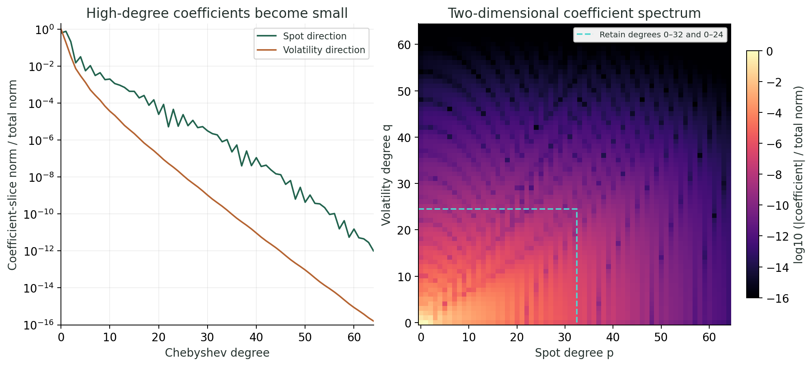
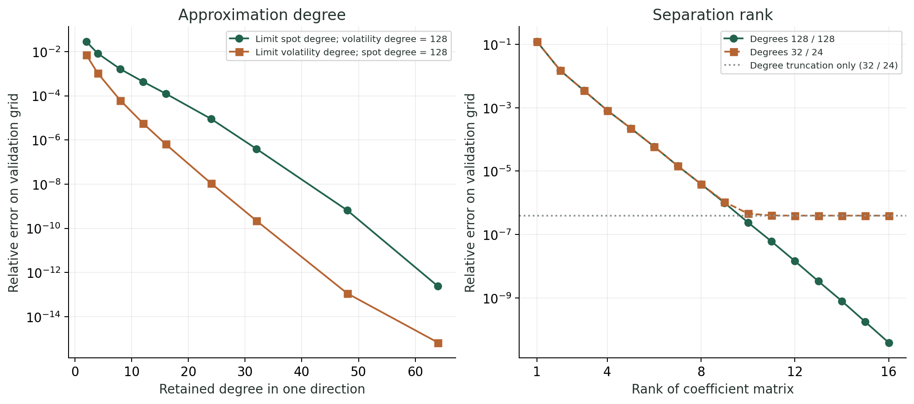

@def title = "Can a smooth price surface be compressed?"
@def page_language = "en"
@def hasmath = true
@def description = "Compressing a Black–Scholes price surface with low rank and low-degree Chebyshev polynomials."

@@explainer

[← Research notes](/research/)

# Can a smooth price surface be compressed?

A Black–Scholes call price as a function of stock price and volatility. How few numbers can describe it?

~~~
<figure>
  
  <figcaption>Stock price 50 to 150, volatility 5 to 60%. Strike 100, maturity 1 year, rate 3%, no dividends.</figcaption>
</figure>
~~~

## Rank

On a 128 × 128 grid, a few separable terms are enough:

$$
C(S,\sigma)\approx\sum_{\alpha=1}^{r}u_\alpha(S)v_\alpha(\sigma).
$$

~~~
<figure>
  
  <figcaption>The singular values drop fast. Cross interpolation roughly follows the SVD error.</figcaption>
</figure>
~~~

## Rows and columns

Matrix cross interpolation with 8 rows and 8 columns gets 0.0010% relative error.

~~~
<figure>
  
  <figcaption>1,984 of 16,384 entries kept. Maximum absolute error 0.0017. The error has its own color scale.</figcaption>
</figure>
~~~

## Degree

The high-degree Chebyshev coefficients are small, so the fine detail can be dropped.

~~~
<figure>
  
  <figcaption>Left: norm per degree. Right: the coefficients. Both divided by the full coefficient norm. Box: degrees 0 to 32 and 0 to 24.</figcaption>
</figure>
~~~

## Both together

Degrees 32 and 24 with rank 8 in the coefficient matrix: 464 coefficients, $3.9\times10^{-6}$ relative error at new test points.

~~~
<figure>
  
  <figcaption>At fixed degree, more rank stops helping at some point.</figcaption>
</figure>
~~~

Degree is about detail along each variable, rank is about how the variables couple. Here both are small.

~~~

  
Methods &amp; code

  
The first part uses the <a href="https://www.columbia.edu/~mh2078/FoundationsFE/BlackScholes.pdf">Black–Scholes formula</a> on a uniform 128 × 128 grid. Relative errors are Frobenius errors. The simple MCI code searches the full residual, so 1,984 is the number of kept entries, not of function evaluations. The reconstruction solves a linear system with the pivot matrix.

  
The Chebyshev part evaluates a separate 129 × 129 Chebyshev–Lobatto grid, with S = 100 + 50x and σ = 0.325 + 0.275y. A type-I DCT gives the usual unnormalized Chebyshev coefficients up to degree 128 in both directions. I checked them against a 193 × 193 grid.

  
Keeping degrees 32 and 24 leaves 33 × 25 = 825 coefficients, with relative error 3.94 × 10⁻⁷. An SVD of this coefficient matrix at rank 8 stores 8(33 + 25) = 464 numbers (singular values folded into one factor). This SVD is in coefficient space, so it is not the best rank-8 fit on a uniform grid.

  
Polynomial errors are measured on a separate 192 × 190 uniform midpoint grid against exact prices. Degree plus rank gives relative error 3.91 × 10⁻⁶ and maximum absolute error 5.46 × 10⁻⁴. Storage counts leave out metadata and construction cost.

  
Low degree bounds the rank, but they are different things. A degree-32/24 coefficient matrix has rank at most 25, and rank 8 is enough here. On the other hand, a product of two degree-100 polynomials has rank 1.

  
Code: <a href="/assets/scripts/bs1d_demo.py">price surface and MCI</a> · <a href="/assets/scripts/bs1d_chebyshev.py">Chebyshev</a> (keep both in the same folder). Data: <a href="/assets/compression/bs1d-results.json">grid results</a> · <a href="/assets/compression/bs1d-chebyshev-results.json">Chebyshev spectra, errors and factors</a>.

  
Further reading: <a href="https://scipost.org/10.21468/SciPostPhys.18.3.104">Núñez Fernández et al., tensor cross interpolation (2025)</a>; <a href="https://www.chebfun.org/publications/Chebfun2paper.pdf">Townsend &amp; Trefethen, Chebfun2 (2013)</a>; <a href="https://docs.scipy.org/doc/scipy/reference/generated/scipy.fft.dct.html">SciPy's DCT definition</a>; <a href="https://www.mdpi.com/2227-7390/13/11/1828">Sakurai, Takahashi &amp; Miyamoto (2025)</a>.

~~~

[Back to research notes](/research/)

@@
