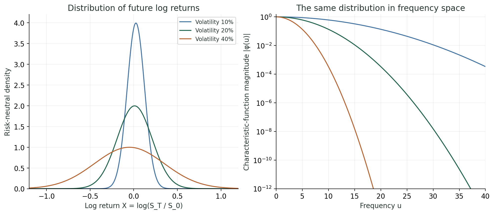
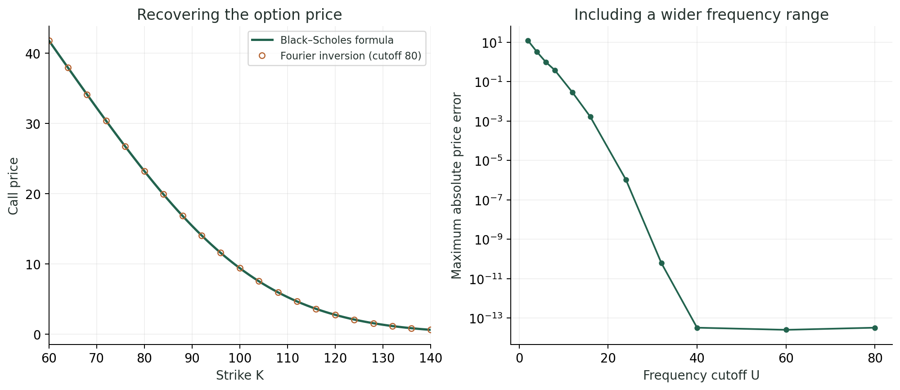

@def title = "Fourier pricing"
@def page_language = "en"
@def hasmath = true
@def description = "A short introduction to option pricing with characteristic functions, checked against the Black–Scholes formula."

@@explainer

[← Research notes](/research/)

# Fourier pricing

Fourier pricing gets the discounted expected payoff from the characteristic function instead of the density. A small Black–Scholes example to check that it works.

## Density and spectrum

For the log return $X=\log(S_T/S_0)$, the characteristic function is

$$
\phi(u)=\mathbb E^{\mathbb Q}[e^{\mathrm{i}uX}].
$$

For Gaussian log returns, a wider distribution has a faster-decaying spectrum.

~~~
<figure>
  
  <figcaption>Same color, same model. Maturity 1 year, rate 3%. Only the magnitude of the spectrum is shown.</figcaption>
</figure>
~~~

## Getting the price back

Multiply the characteristic function by the transform of a damped payoff and integrate.

~~~
<figure>
  
  <figcaption>Spot 100, volatility 20%, maturity 1 year, rate 3%, no dividends. Over 81 strikes (60 to 140), the maximum absolute error is below 10⁻¹⁰ at cutoff 80.</figcaption>
</figure>
~~~

The integrand, or how it depends on the parameters, might be compressible. See the [price-surface example](/compression/).

~~~

  
Methods &amp; code

  
I use the <a href="https://wwwf.imperial.ac.uk/~ajacquie/IC_Num_Methods/IC_Num_Methods_Docs/Literature/CarrMadan.pdf">Carr–Madan damped Fourier formula</a> with log strike k = log(K/S₀) and the characteristic function of X = log(S_T/S₀). The transformed quantity is the normalized call price times exp(αk), with α = 1.5. The integrand uses the characteristic function at u − i(α + 1). After inversion, remove the damping and multiply by S₀.

  
The integral over 0 ≤ u ≤ U uses adaptive quadrature with absolute and relative tolerance 10⁻¹². No FFT. The convergence plot shows the maximum absolute price error over the 81 strikes. At large cutoffs, rounding error dominates. How fast the spectrum decays, and hence the cutoff needed, depends on the model and parameters.

  
The code checks the characteristic function against direct integration of the density, its normalization and risk-neutral mean, and compares prices with Black–Scholes for several strikes, volatilities, maturities and damping values.

  
<a href="/assets/scripts/fourier_pricing_demo.py">Code</a> · <a href="/assets/fourier-pricing/results.json">prices and convergence data</a>. Put <a href="/assets/scripts/bs1d_demo.py">bs1d_demo.py</a> in the same folder.

  
Related: <a href="https://www.mdpi.com/2227-7390/13/11/1828">Learning parameter dependence for Fourier-based option pricing with tensor trains</a>, Sakurai, Takahashi &amp; Miyamoto (2025).

~~~

[Back to research notes](/research/)

@@
