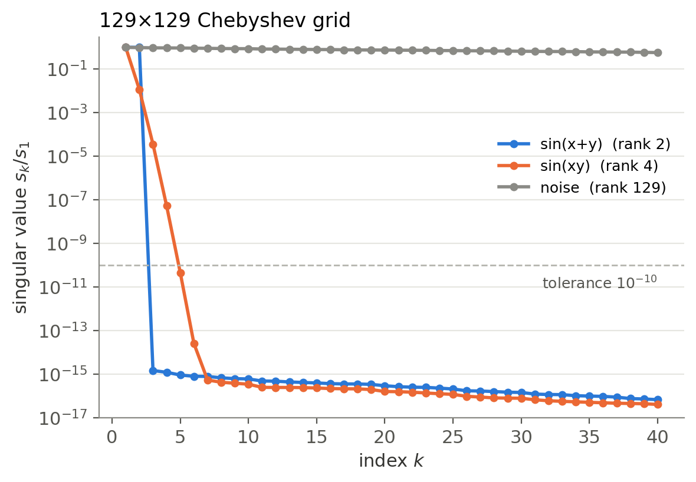

@def title = "What does low rank mean?"
@def page_language = "en"
@def hasmath = true
@def description = "Low rank written out: sin(x+y) as two outer products, sin x on a binary grid as a product of 2x2 matrices, and how the Chebyshev degree bounds the quantics rank."

@@explainer

[← Research notes](/research/)

# What does low rank mean?

@@article-lead
A table of numbers that splits into a few products.
@@

## Two variables

The addition formula splits $\sin(x+y)$ into two products:

$$ \sin(x+y)=\sin x\,\cos y+\cos x\,\sin y. $$

On grids $x_1,\dots,x_n$ and $y_1,\dots,y_n$ the $n\times n$ table of values is a sum of two column-times-row products:

$$
\big[\sin(x_i+y_j)\big]_{ij}
=\begin{pmatrix}\sin x_1\\ \vdots\\ \sin x_n\end{pmatrix}
\begin{pmatrix}\cos y_1 & \cdots & \cos y_n\end{pmatrix}
+\begin{pmatrix}\cos x_1\\ \vdots\\ \cos x_n\end{pmatrix}
\begin{pmatrix}\sin y_1 & \cdots & \sin y_n\end{pmatrix}.
$$

The matrix has rank 2. For $n=100$, its $10\,000$ entries are described by $400$ numbers.

In general, $f$ is **low rank** if

$$ f(x,y)\approx\sum_{k=1}^{r} g_k(x)\,h_k(y) $$

with small $r$. The singular values show how many terms are needed.

~~~
<figure>
  
  <figcaption>Singular values on a 129 × 129 Chebyshev grid. Rank counted at sk/s1 &gt; 10−10.</figcaption>
</figure>
~~~

$\sin(x+y)$ has rank exactly 2. $\sin(xy)$ has no finite rank, but 4 terms reach $10^{-10}$. Noise does not split and is full rank.

## One variable on a binary grid (QTT)

Take 8 uniform points $x_i=a+h\,i$ and write $i=b_1+2b_2+4b_3$ with $b_k\in\{0,1\}$:

$$ x_i=a+h\,b_1+2h\,b_2+4h\,b_3. $$

With $v(\theta)=(\cos\theta,\ \sin\theta)$ and

$$ R(\beta)=\begin{pmatrix}\cos\beta & \sin\beta\\ -\sin\beta & \cos\beta\end{pmatrix}, $$

the addition formula reads $v(\alpha+\beta)=v(\alpha)\,R(\beta)$. Applying it three times gives

$$ \sin x_i=v(a)\,R(h\,b_1)\,R(2h\,b_2)\,R(4h\,b_3)\begin{pmatrix}0\\1\end{pmatrix}. $$

Each $2\times2$ factor depends on one binary digit. This is a tensor train in the digits, the quantics tensor train (QTT), with rank 2. With $2^L$ points there are $L$ factors, still $2\times2$.

## QTT rank and the Chebyshev degree

A polynomial of degree $p$ has small QTT rank:

- **Uniform grid.** At a cut, $x=x_{\rm L}+x_{\rm R}$, where $x_{\rm L}$ comes from the low digits and $x_{\rm R}$ from the high ones. Expanding $(x_{\rm L}+x_{\rm R})^k$ leaves only $1,x_{\rm L},\dots,x_{\rm L}^{p}$, so the rank is at most $p+1$.
- **Chebyshev grid** $x_j=\cos\theta_j$, $\theta_j=\pi j/N$. Here $T_k(x_j)=\cos(k\theta_j)$ and $\theta_j=\theta_{\rm L}+\theta_{\rm R}$, so
  $$ \cos k\theta=\cos k\theta_{\rm L}\cos k\theta_{\rm R}-\sin k\theta_{\rm L}\sin k\theta_{\rm R}. $$
  The rank is at most $2p+1$.

A function whose Chebyshev coefficients fall below $\varepsilon$ after degree $p$ therefore has QTT rank at most $p+1$ or $2p+1$ at that accuracy. Fast coefficient decay means low QTT rank. The bound can be loose:

| $\omega$ | Chebyshev degree $p$ | QTT rank, uniform | QTT rank, Chebyshev | bound $2p+1$ |
|---:|---:|---:|---:|---:|
| 1 | 9 | 2 | 7 | 19 |
| 10 | 27 | 2 | 10 | 55 |
| 100 | 135 | 2 | 16 | 271 |

$\sin(\omega x)$ on $2^{12}$ points, tolerance $10^{-10}$. On the uniform grid the addition formula gives rank 2 at any $\omega$, well below $p+1$.

[Details (Japanese, PDF)](/assets/low-rank/low-rank-note-ja.pdf) · [Data](/assets/low-rank/results/qtt_rank_sin.csv) · [Script](/assets/low-rank/low_rank.py)

[Back to research notes](/research/)

@@
