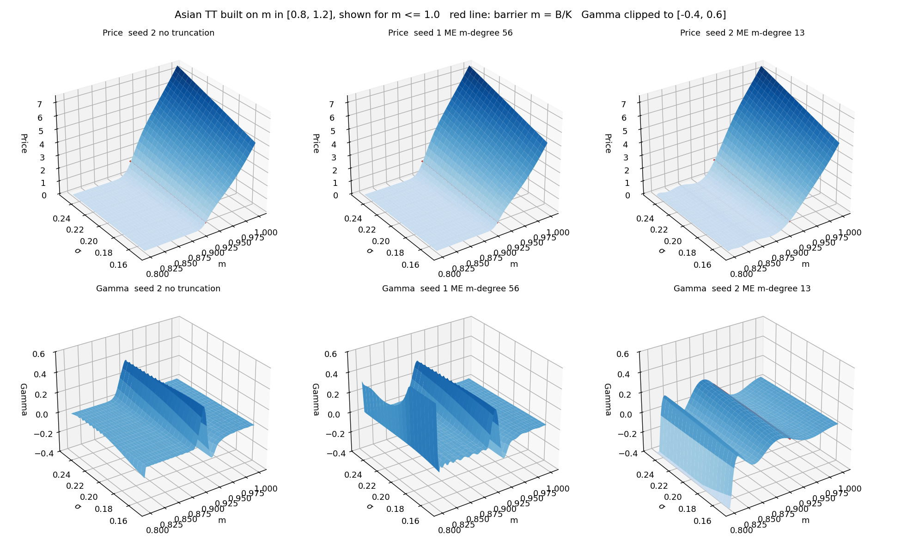
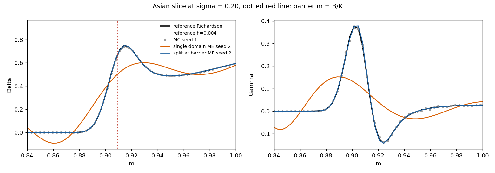
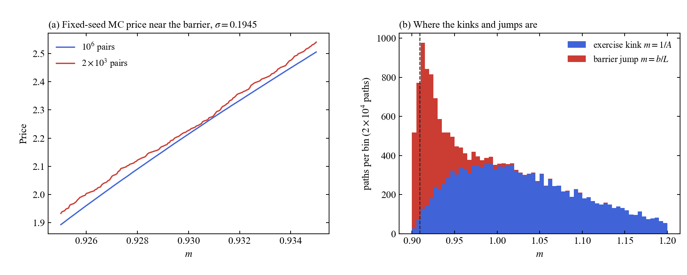

@def title = "Kinks in option prices"
@def page_language = "en"
@def hasmath = true
@def description = "Where an Asian barrier option price bends sharply, what this does to a Chebyshev tensor train, and where the kinks of a Monte Carlo estimate come from."

@@explainer

[← Research notes](/research/)

# Kinks in option prices

An Asian barrier call over moneyness $m=S_0/K$ and volatility $\sigma$, with the barrier at $m=B/K\approx0.909$. This time the tensor train is built on $m\in[0.8,1.2]$, so the barrier is inside the domain.

## Barrier inside the domain

~~~
<figure>
  
  <figcaption>Price (top) and Gamma (bottom) for $m\le1$. Left: no degree truncation. Middle and right: degrees in $m$ chosen by the truncation rule for two Monte Carlo seeds. The red line is the barrier.</figcaption>
</figure>
~~~

The price goes up steeply just above the barrier, and Gamma has a sharp peak there. With degree 13 in $m$ the peak gets smeared into a wave. With the barrier inside the domain, the truncation rule picks a degree this low for some seeds.

~~~
<figure>
  
  <figcaption>Delta and Gamma at $\sigma=0.20$. Splitting the domain at the barrier follows the reference.</figcaption>
</figure>
~~~

If I split the domain at the barrier, the steep part sits at the edge of each piece and the peak comes back.

## Where the kinks come from

In a Monte Carlo estimate, each path pays $mA-1$ once $m$ is above its own threshold $\max(b/L,\,1/A)$. Here $A$ is the path's average, $L$ its lowest running average, and $b=B/K$. At $m=1/A$ the path starts finishing in the money, which gives a kink. At $m=b/L$ the path stops being knocked out and pays right away, which gives a small jump.

~~~
<figure>
  
  <figcaption>(a) Fixed-seed Monte Carlo prices near the barrier. (b) Where the exercise kinks and barrier jumps of $2\times10^4$ paths are.</figcaption>
</figure>
~~~

The barrier jumps pile up just above the barrier, and the exercise kinks are spread over the whole domain. With few samples the price is visibly jagged. With many, the kinks average out into a smooth curve.

See also: [Option prices near expiry](/option-maturity/) · [Chebyshev interpolation across a kink](/chebyshev-spline/) · [Where does TCI sample a noisy price surface?](/tci-sampling/)

[Back to research notes](/research/)

@@
