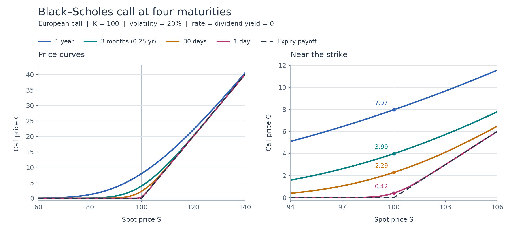

@def title = "Option prices near expiry"
@def page_language = "en"
@def hasmath = true
@def description = "Black–Scholes call prices at shrinking maturities, the curvature that builds up near the strike, and what it means for polynomial approximation."

@@explainer

[← Research notes](/research/)

# Option prices near expiry

A call price is smooth in the spot before expiry, but at expiry it is the kinked payoff. I wanted to see how fast it gets there, so I shortened the maturity of a European call and kept everything else fixed.

~~~
<figure>
  
  <figcaption>Left: spot prices from 60 to 140. Right: close-up near the strike. Markers give the price at S = 100.</figcaption>
</figure>
~~~

## Setting

Write $\tau=T-t$ for the remaining maturity. Strike $K=100$, volatility $\sigma=0.2$, and the interest rate and dividend yield are zero. For $S>0$ and $\tau>0$ the Black–Scholes call price is

$$
C(S,\tau)=S\Phi(d_1)-K\Phi(d_2),\qquad
d_1=\frac{\log(S/K)+\sigma^2\tau/2}{\sigma\sqrt{\tau}},\qquad
d_2=d_1-\sigma\sqrt{\tau},
$$

with $\Phi$ the standard normal distribution function. At expiry the price is the payoff,

$$
C(S,0)=(S-K)_+.
$$

| Remaining maturity | Years | Price at $S=K=100$ |
| --- | ---: | ---: |
| 1 year | 1 | 7.965567 |
| 3 months | 0.25 | 3.987761 |
| 30 days | $30/365$ | 2.287151 |
| 1 day | $1/365$ | 0.417630 |
| Expiry | 0 | 0 |

Days are counted with a 365-day year. With zero rates and fixed spot and volatility, the price falls as the maturity shrinks. At the strike the formula reduces to

$$
C(K,\tau)=K\left[2\Phi\!\left(\frac{\sigma\sqrt{\tau}}{2}\right)-1\right]
\sim\frac{K\sigma\sqrt{\tau}}{\sqrt{2\pi}}
\quad(\tau\downarrow0),
$$

so the at-the-money price goes to zero like $\sqrt{\tau}$.

## Curvature near the strike

For $\tau>0$ the price is smooth in $S$, with

$$
\Delta=\Phi(d_1),\qquad
\Gamma=\frac{\phi(d_1)}{S\sigma\sqrt{\tau}},
$$

where $\phi$ is the standard normal density. Near expiry, Delta goes from about 0 to about 1 over a spot range of width roughly $K\sigma\sqrt{\tau}$ around the strike. At the strike,

$$
\Gamma(K,\tau)\sim\frac{1}{K\sigma\sqrt{2\pi\tau}},
$$

which grows without bound. At expiry the payoff has a kink and Delta and Gamma are not defined at the strike.

## What this means for approximation

If I want one Chebyshev approximation over spot and maturity, $\tau=0$ is the problem. The bounds in [Gaß et al. (2018)](https://link.springer.com/article/10.1007/s00780-018-0361-y) (my [note](/chebyshev-pricing/)) depend on how far the price extends analytically, and near $\tau=0$ that shrinks to nothing. The kink and the $\sqrt{\tau}$ at the strike are both there.

Two things I'd try:

- Split near the strike. For $\tau>0$ the price still isn't linear on either side, but at expiry it is, like the [kink example](/chebyshev-spline/).
- Use better variables. With zero rates, $x=S/K$ and $w=\sigma\sqrt{\tau}$ give $C=K\,G(x,w)$ with
  $$
  G(x,w)=x\Phi\!\left(\frac{\log x}{w}+\frac{w}{2}\right)
  -\Phi\!\left(\frac{\log x}{w}-\frac{w}{2}\right),\qquad G(x,0)=(x-1)_+.
  $$
  That merges volatility and maturity into one input. The kink at $(x,w)=(1,0)$ is still there.

I haven't measured interpolation errors or TT ranks for any of this yet.

~~~

  
Code &amp; checks

  
<a href="/assets/option-maturity/plot_maturity.py">Python script</a> (NumPy, SciPy, Matplotlib). Run <code>python3 -B plot_maturity.py new_results</code> with a new output directory. It writes the figure as PNG and SVG, the five price curves on 3,201 spot points, and a summary of checks.

  
In the saved run, four prices agree with direct integration of the payoff to within 10−10. It also checks price bounds, monotonicity in maturity, the expiry limit, and Delta and Gamma by finite differences.

  
Downloads: <a href="/assets/option-maturity/results/call-maturity.png">PNG</a> · <a href="/assets/option-maturity/results/call-maturity.svg">SVG</a> · <a href="/assets/option-maturity/results/call-maturity.csv">price data</a> · <a href="/assets/option-maturity/results/checks.json">checks and package versions</a>.

~~~

[Back to research notes](/research/)

@@
