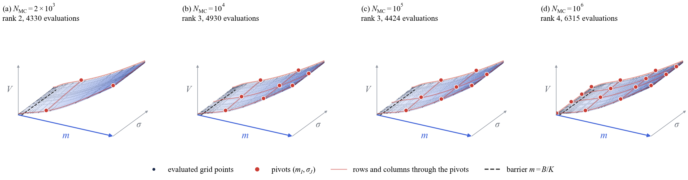
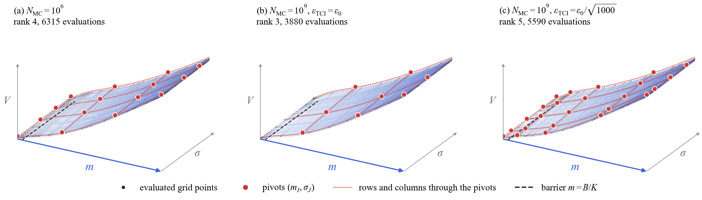
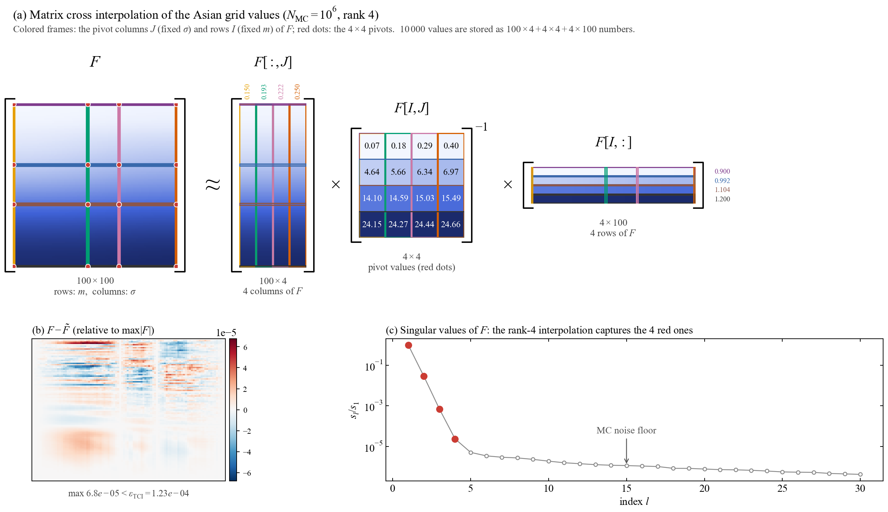

@def title = "Where does TCI sample a noisy price surface?"
@def page_language = "en"
@def hasmath = true
@def description = "Tensor cross interpolation of a fixed-seed Monte Carlo Asian barrier price grid: how the evaluated points, pivots and rank change with the Monte Carlo sample size."

@@explainer

[← Research notes](/research/)

# Where does TCI sample a noisy price surface?

@@article-lead
Fewer Monte Carlo samples, a looser tolerance, fewer pivots.
@@

Tensor cross interpolation (TCI) builds a low-rank approximation from a small set of function values. When the function values are Monte Carlo (MC) prices, they carry sampling noise. This note asks where TCI evaluates a noisy price grid, and where it places its pivots, as the number of MC samples changes.

The example is an Asian barrier call over moneyness $m=S_0/K\in[0.9,1.2]$ and volatility $\sigma\in[0.15,0.25]$, on a $100\times100$ Chebyshev–Lobatto grid. All grid points use the same random numbers (a fixed seed). The barrier lies at $m=B/K\approx0.909$, just inside the lower end of the interval.

## Setup

The grid prices come from saved batches of $10^6$ antithetic pairs that share their random numbers across the grid. Averaging the first $k$ batches gives a fixed-seed grid with $k\times10^6$ pairs. Smaller sample sizes use the first $n$ pairs of one batch, so all grids are nested prefixes of the same random stream. At $10^6$ pairs, the recomputed grid matches the saved batch exactly.

TCI uses rook pivoting, at most 20 sweeps and a relative error criterion. The tolerance follows the rule

$$
\varepsilon_{\rm TCI}=\frac{\mathrm{SE}_{\max}}{2\hat V_{\max}},
$$

where the largest standard error $\mathrm{SE}_{\max}$ and the largest price $\hat V_{\max}$ are estimated from the same samples at 100 random parameter points. Fewer samples therefore give a looser tolerance.

## Fewer samples: a coarser cross

~~~
<figure>
  
  <figcaption>Evaluated grid points (dark), pivots (red dots), the rows and columns through them (light red), and the barrier (dashed). The tolerance follows the rule above for each sample size.</figcaption>
</figure>
~~~

| MC pairs | $\varepsilon_{\rm TCI}$ | Rank | Evaluated points | Pivot $m$ values |
| ---: | ---: | ---: | ---: | --- |
| $2\times10^3$ | $2.75\times10^{-3}$ | 2 | 4330 | 0.99, 1.20 |
| $10^4$ | $1.23\times10^{-3}$ | 3 | 4930 | 0.99, 1.11, 1.20 |
| $10^5$ | $3.89\times10^{-4}$ | 3 | 4424 | 0.99, 1.10, 1.20 |
| $10^6$ | $1.23\times10^{-4}$ | 4 | 6315 | 0.90, 0.99, 1.10, 1.20 |

**With fewer samples, TCI keeps only the coarse shape of the surface and stops.** The main pivots stay near $m\approx0.99$, $1.10$ and $1.20$ at every sample size. TCI evaluates 40–60% of the grid. Rook search and the initial pivot search scan whole rows and columns, not only the points near the pivots.

## More samples: pivots move toward the barrier

~~~
<figure>
  
  <figcaption>(a) $10^6$ pairs. (b) $10^9$ pairs at the same tolerance as (a). (c) $10^9$ pairs with the tolerance tightened by $\sqrt{1000}$.</figcaption>
</figure>
~~~

At $10^6$ pairs, one pivot sits at $m=0.90$, below the barrier, where the price is almost zero. With $10^9$ pairs and the same tolerance, this pivot disappears and the rank drops to 3. **It was spent on MC noise rather than on the price.** With a tighter tolerance, a new pivot appears at $m\approx0.93$, just above the barrier, where the price rises steeply. The rank becomes 5.

## Matrix cross interpolation

With two variables, the grid values form a matrix $F$ with rows indexed by $m$ and columns by $\sigma$. TCI is then a matrix cross interpolation,

$$
F\approx F[:,J]\;F[I,J]^{-1}\;F[I,:],
$$

where $I$ are the pivot rows (fixed $m$) and $J$ the pivot columns (fixed $\sigma$). The pivots are the grid points $I\times J$. The approximation uses the full rows and columns through them.

~~~
<figure>
  
  <figcaption>(a) The cross interpolation at $10^6$ pairs, drawn as matrices. Matching colors trace each pivot column and row of $F$ to the factors. The $4\times4$ pivot values are prices. (b) Reconstruction error. (c) Singular values of $F$.</figcaption>
</figure>
~~~

At $10^6$ pairs, the $10\,000$ grid values are represented by $100\times4+4\times4+4\times100$ numbers. The largest reconstruction error is $6.8\times10^{-5}$ of $\max|F|$, below the tolerance $1.23\times10^{-4}$. The singular values of $F$ fall as $1$, $2.9\times10^{-2}$, $6.9\times10^{-4}$ and $2.4\times10^{-5}$, then level off near $3\times10^{-6}$–$5\times10^{-6}$. This flat tail is the MC noise floor, and the rank-4 cross stops just before it. TCI stops on the maximum error, so its tolerance is not a threshold on singular values.

## Caveats

- One random stream only. The random numbers differ from the production fixed seed, so the rank at $10^6$ pairs (4) differs from the production TT (3).
- The note looks at sample locations and pivots, not at the accuracy of prices or Greeks.

## Files

- [Note with details (Japanese, PDF)](/assets/tci-sampling/asian-tci-sampling-note-ja.pdf)
- [Small sample sizes: summary](/assets/tci-sampling/data/small_n_summary.csv) and [tolerances](/assets/tci-sampling/data/tolerance.csv)
- [Large sample sizes: summary](/assets/tci-sampling/data/large_n_summary.csv)

[Back to research notes](/research/)

@@
